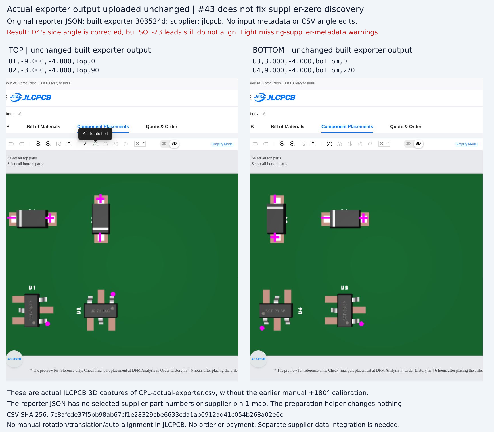
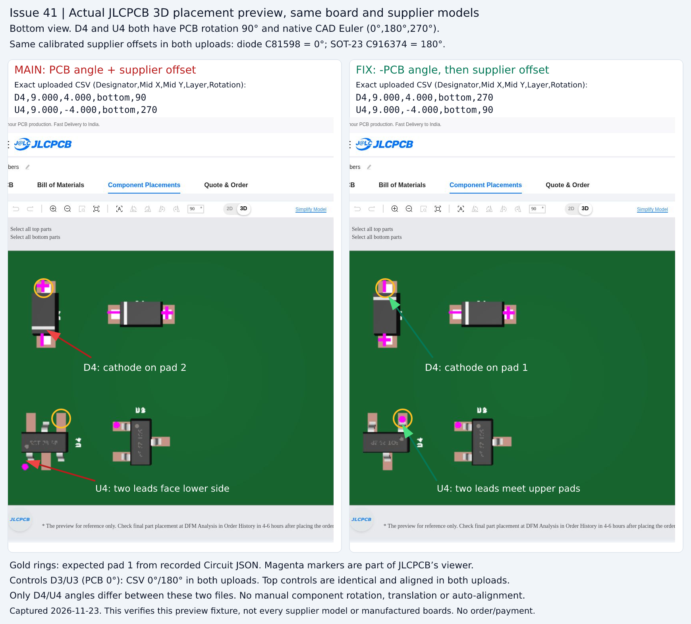
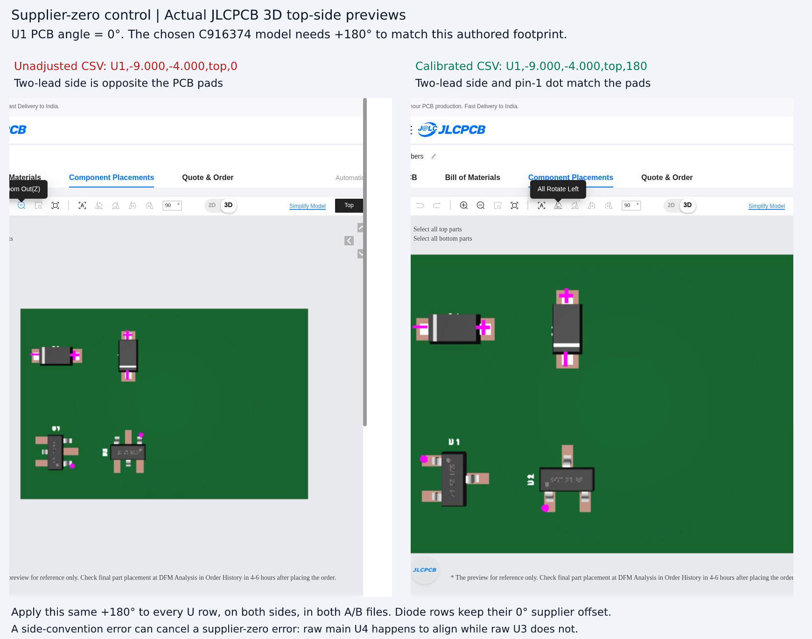
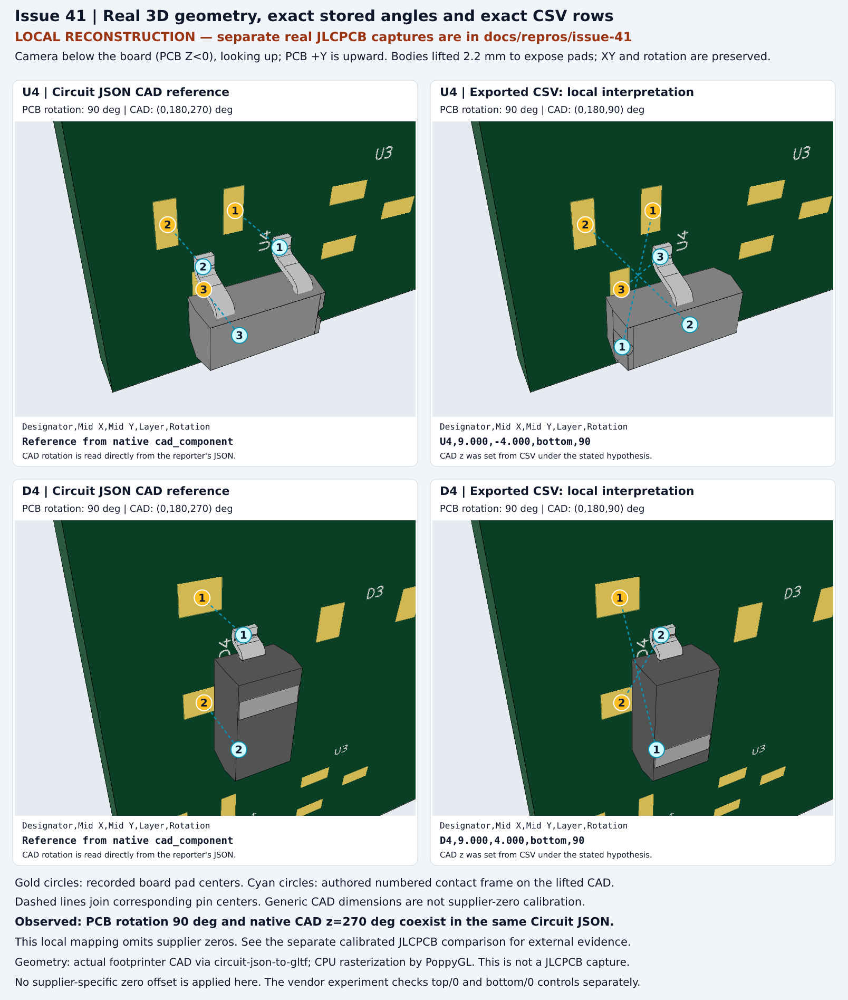

# Issue 41: bottom-side placement reproduction

**PR #43 fixes the JLCPCB bottom-side angle conversion only. It does not automatically produce a fully aligned CSV from the reporter's JSON.** The successful A/B comparison below used an explicitly supplied 180-degree SOT-23 calibration. That comparison must not be presented as verification of an unchanged automatic export.

## Unchanged exporter output: still incomplete



On 2026-11-23 we built #43 at `303524ddbb09a0f98b48a940aae2eb6b87e1089e` and called `convertCircuitJsonToPickAndPlaceCsv(originalReporterJson, { supplier: "jlcpcb" })`, with a diagnostic collector. We uploaded the returned string directly as `CPL-actual-exporter.csv`. No source orientation metadata, PCB geometry or CSV angles were edited. The parsed converter input remained unchanged; the output SHA-256 is `7c8afcde37f5bb98ab67cf1e28329cbe6633cda1ab0912ad41c054b268a02e6c`.

JLCPCB's actual 3D preview shows that D4's cathode is corrected, while the chosen SOT-23 model's leads still fail to align on both sides. All eight exported rows report `missing_supplier_pin1_location`. The original JSON's supplier part-number arrays are empty and no supplier orientation maps are present. Calling `populatePartOrientationMetadata` without inventing part selections changes nothing. Therefore this is **not a complete automatic supplier-correct placement export**.

[`actual-exporter-provenance.json`](actual-exporter-provenance.json) records the exact input/output hashes, built exporter revision, options, warnings and CSV. The unaltered top/bottom and upload captures are in [`jlcpcb/`](jlcpcb/).

To repeat with the original `output/circuit.json` from the issue attachment:

```sh
bun run build
bun docs/repros/issue-41/generate-unchanged-cpl.ts /path/to/reporter/output/circuit.json /path/to/CPL-actual-exporter.csv
```

The generator writes the converter's returned CSV without postprocessing. The separate provenance file records the result. It is intentionally not a script that adds a per-designator correction.

## Where the complete solution belongs

Keep the supplier-specific side conversion in this exporter; do not change Core's global PCB rotation convention to accommodate JLCPCB. Core/parts-engine should provide stable authored/supplier CAD frames and a separately sourced assembly-zero offset for the **selected** supplier part. Circuit JSON should preserve the distinction between a confirmed zero and missing factory data. The CLI's fabrication export should resolve the required metadata for prebuilt JSON and reject or explicitly flag unresolved assembly orientation instead of silently writing a supposedly verified placement file.

Related existing work already separates these concepts:

- [Circuit JSON #1006](https://github.com/tscircuit/circuit-json/pull/1006): separate supplier assembly-zero field; missing is unknown.
- [Core #5461](https://github.com/tscircuit/core/pull/5461): carry that supplier offset through analysis and caching.
- [PnP exporter #39](https://github.com/tscircuit/circuit-json-to-pnp-csv/pull/39): apply catalog assembly offsets separately from CAD alignment.

All three were open and unmerged when checked. Their approach is complementary to the side-angle fix; they do not prove that the real catalog currently supplies correct offsets for C81598/C916374. The measured 180-degree correction in this experiment is a combined supplier alignment requirement; screenshots alone do not establish which portion is CAD alignment versus factory zero.

Current official CLI source still calls the converter with `{ supplier: "jlcpcb" }`, without metadata preparation or strict mode ([CLI 9f08f0f](https://github.com/tscircuit/cli/blob/9f08f0ffeaef320222f4a94bd4cc1658b19f335e/lib/shared/export-snippet.ts#L459)). A complete integration should be verified with a real selected-part input, real supplier metadata and the unchanged generated CSV. No complete automatic integration is claimed here.

## Calibrated A/B comparison: isolates the side conversion



Both uploads use the same 24 x 16 mm Gerbers, BOM, coordinates, part selections and supplier-zero offsets. No component was manually rotated, translated or auto-aligned in JLCPCB. The screenshots retain the viewer's selected **3D** mode. Gold rings mark the unchanged Circuit JSON pad-1 positions; arrows identify the supplier model's cathode/lead orientation. These are actual browser captures, not locally reconstructed supplier models.

| Part | Circuit JSON PCB angle | Saved CAD Euler | Supplier offset used in both uploads | Main CSV angle | Proposed CSV angle | Observed result |
| --- | --- | --- | --- | --- | --- | --- |
| D4, bottom | 90 | (0,180,270) | 0 | 90 | 270 | Main cathode on pad 2; proposed cathode on pad 1 |
| U4, bottom | 90 | (0,180,270) | 180 | 270 | 90 | Main two-lead side faces away from upper pads; proposed leads and pin 1 match |
| D3, bottom control | 0 | (0,180,0) | 0 | 0 | 0 | Same aligned placement |
| U3, bottom control | 0 | (0,180,0) | 180 | 180 | 180 | Same aligned placement |

With those explicitly supplied offsets, the tested side conversion is `normalize(-pcb.rotation + supplierOffset)` for JLCPCB bottom rows. Top rows keep `normalize(pcb.rotation + supplierOffset)`. Generic exports and other suppliers retain their existing conventions. The native CAD's Euler z angle is **not the final vendor CSV angle**: U4's CAD z is 270, but its correctly calibrated JLCPCB row is 90. Different coordinate frames and supplier zeros must be accounted for separately.

## Supplier-zero control, before interpreting bottom rotation



The BOM uses C81598 (SOD-123 1N4148W) and C916374 (SOT-23 MMBT3904). These are explicit experiment selections, not part numbers supplied by the reporter. Catalogue references: [C81598](https://jlcpcb.com/partdetail/1N4148W/C81598), [C916374](https://jlcpcb.com/partdetail/C916374).

The raw uploads revealed that this SOT-23 supplier model's zero is 180 degrees from the authored footprint. We then applied **the same +180 degrees to every U row, on both sides, in both files**; D rows retain offset 0. The top-side captures for these two calibrated uploads are byte-identical. U1/U2, D1/D2 and bottom-zero U3/D3 align before the rotated-bottom case is interpreted.

This matters: raw main U4 happens to align because the side error and the missing 180-degree supplier correction cancel. Raw U3 still fails. Looking only at U4, or assuming supplier offset 0, would give a misleading verdict.

Calibration was applied explicitly to the experiment CSVs, without guessing missing supplier metadata. The regression test encodes those measured constants as synthetic frame pairs on a copy of the fixture; it does not claim those metadata pairs were supplied by the reporter. No geometry or native CAD transform is changed.

## Inputs and unaltered evidence

- `gerbers.zip`: the common board; JLCPCB detected 24 x 16 mm, two layers. Its standard-assembly quote also displays a 70 x 70 mm rail/panel envelope.
- `BOM.csv`: the two supplier models listed above; JLCPCB matched both parts on both sides.
- `CPL-main.csv` and `CPL-proposed.csv`: raw outputs, without supplier-zero correction. Only D4/U4 change, 90 to 270.
- `CPL-main-U-offset-180.csv` and `CPL-proposed-U-offset-180.csv`: the calibrated A/B pair shown above. Only D4/U4 angles differ between them; their other six rows are identical.
- [`jlcpcb/`](jlcpcb/): unaltered captures of raw/control and calibrated top/bottom views, plus upload checkpoints. The manifest records their SHA-256 hashes. No account, quote identifiers or credentials are included.
- `render-jlcpcb-evidence.ts`: places annotations and exact CSV text around cropped copies of those captures. It does not generate replacement supplier geometry.

Reproduce: upload the common Gerbers; choose Standard assembly, Both Sides; upload the BOM and one calibrated CPL; process the files and verify C81598/C916374. Open Component Placements in 3D and capture Top and Bottom. Replace only the CPL with the other calibrated file and repeat. Leave component rotation/translation/auto-alignment controls untouched. Do not order or pay.

During this run the viewer initially rendered blank and logged `adapt` / `setCameraDirect` errors. Reloading alone did not resolve it; switching 2D then 3D restored the actual models. All final comparisons were captured after model loading. No order or payment was submitted.

Regenerate the annotated vendor evidence from the saved captures:

```sh
bun docs/repros/issue-41/render-jlcpcb-evidence.ts
```

## Native Circuit JSON 3D regression snapshot



This separate local image uses `circuit-json-to-gltf@0.0.151` and `poppygl@0.0.37`. The left column reads the original `cad_component` transform. The right substitutes the exact CSV rotation into CAD z under an explicitly labeled local mapping, with no supplier-zero adjustment. It must not be mistaken for the real JLCPCB captures above. All panels share a camera below the PCB, looking up; components are lifted 2.2 mm to expose pads while preserving XY and rotation. Gold markers identify recorded board pad centers; cyan markers identify the authored contact frame, not calibrated supplier lead centers.

The CAD, PCB, pad and silkscreen records were copied unchanged from the reporter's attachment. Both PCB/CAD angle records and exact exported CSV rows appear in the image. The test checks snapshot equality and input immutability.

```sh
bun install --frozen-lockfile
BUN_UPDATE_SNAPSHOTS=1 bun test tests/bottom-side-rotation-3d.test.ts
```

Run without `BUN_UPDATE_SNAPSHOTS` to compare with the stored snapshot. The reproduction PR keeps the behavioral regression tests as `test.failing`; the fix enables them and updates the local snapshots. The exact calibrated proposed CPL is an external-preview regression fixture. Broader angle/metadata cases test the selected mathematical contract; those cases were not all independently uploaded to JLCPCB.

Missing/incompatible supplier metadata remains a separate warning or strict-mode error. Side conversion does not determine an unknown part-specific zero. This experiment demonstrates why that warning must be taken seriously.
