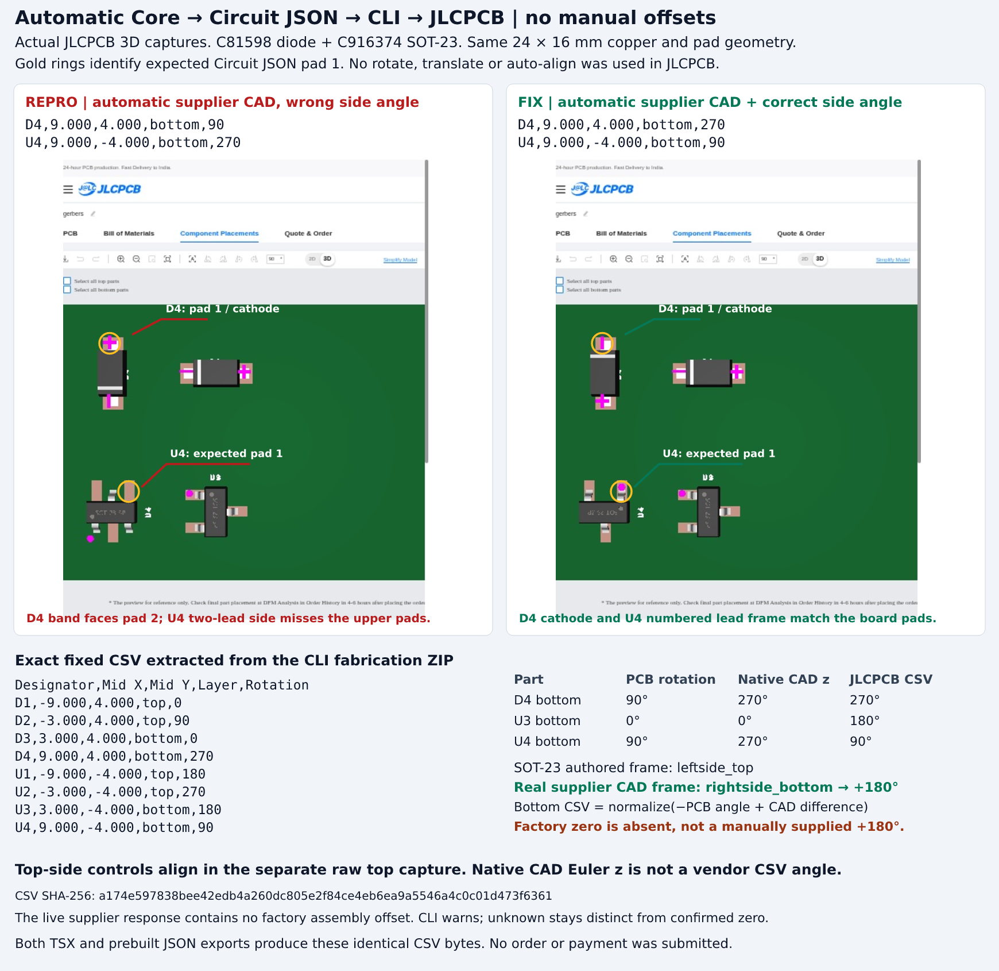
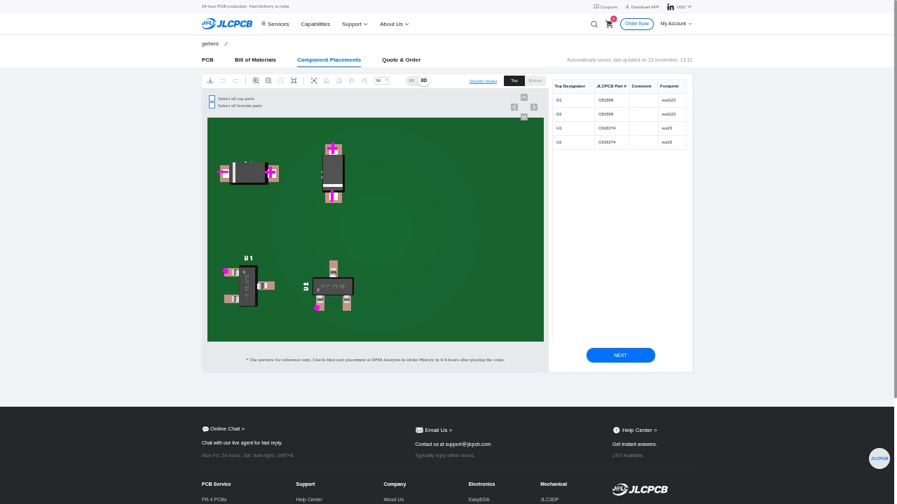

# Automatic supplier-selected placement verification



The full solution recovers a canonical authored footprint frame in Core, retains supplier CAD and optional factory assembly references separately in Circuit JSON, converts the JLCPCB bottom-side angle in the exporter, and prepares selected-part metadata in CLI fabrication exports, including prebuilt JSON.

The SOT-23 correction is automatic. The live C916374 CAD has pin 1 at `rightside_bottom`; the authored `sot23` is `leftside_top`. Their CAD difference is 180 degrees. No 180-degree offset is inserted into the design, supplier response or CSV. The supplier response has no factory assembly offset: this remains unknown and the CLI reports it. A catalog CAD frame is not proof of a factory zero for every part.

## Exact automatic verification

The reporter's 24 × 16 mm TSX was changed only to select C81598 for D1–D4 and C916374 for U1–U4. All 20 emitted pad records match the original reporter JSON. Live supplier requests, generated frames and absent factory offsets are recorded in [generated-circuit-provenance.json](full-pipeline/generated-circuit-provenance.json).

Run from the pinned CLI checkout:

```sh
bun cli/main.ts export /path/to/repro.circuit.tsx -f gerbers -o /path/to/fabrication.zip
```

We extracted `bom.csv` and `pick_and_place.csv` from that ZIP without postprocessing and uploaded them as [BOM-generated.csv](full-pipeline/BOM-generated.csv) and [CPL-generated.csv](full-pipeline/CPL-generated.csv). SHA-256 of the uploaded CSV: `a174e597838bee42edb4a260dc805e2f84ce4eb6ea9a5546a4c0c01d473f6361`. The actual CLI command using prebuilt JSON produced the same bytes. All 11 generated Gerber layer geometries match the already-uploaded board after ignoring software/timestamp comments. JLCPCB matched the real selected supplier models. Neither rotation, translation nor auto-alignment controls were used; no order or payment was submitted.



The fixed CSV is D1=0, D2=90, D3=0, D4=270, U1=180, U2=270, U3=180, U4=90. The actual 3D top/bottom views show aligned diode cathodes and SOT-23 leads, including both zero-angle controls and both rotated-bottom cases.

The automatic reproduction CSV was independently generated from the same Core output using this repro's built exporter. It exports D4=90 and U4=270. Uploading [that exact CSV](full-pipeline/CPL-repro-generated.csv) reproduces their wrong cathode/lead orientations. Its other six rows are identical to the fix. This before/after comparison uses real supplier data throughout, with no manual calibration.

[verification.json](full-pipeline/verification.json) contains exact revisions, hashes, checks and raw-capture hashes. [fabrication.zip](full-pipeline/fabrication.zip) is the actual final CLI output. The generated Core fixture and original selected-part TSX are under `tests/assets/real-supplier/`.

## Existing JSON with stale derived frames

The original reporter JSON already contains incorrect cached authored frames for D3 and U3. The CLI now refreshes these derived fields from the unchanged numbered pads. Explicit metadata remains a fallback when pads cannot be analyzed; physical geometry is authoritative when available.

We also ran the actual CLI on [selected-original.circuit.json](full-pipeline/selected-original.circuit.json), changing only supplier part-number selections and retaining every original geometry, angle and stale pin-1 field. The input file remained byte-identical. Its exported CSV has the same `a174e5…` SHA-256 as the exact file already verified in JLCPCB. No input metadata or CSV offset was edited. [Legacy verification](full-pipeline/legacy-verification.json) and [actual legacy export ZIP](full-pipeline/legacy-fabrication.zip) record this additional path.

## Coordinate frames

For JLCPCB bottom placements: `normalize(-pcb.rotation + CAD_frame_difference + known_assembly_offset)`. For top placements, retain `+pcb.rotation`. The CAD difference and separately sourced factory offset are not negated. Missing factory data does not become an explicit zero.

U4 illustrates why these fields differ: Circuit JSON PCB rotation is 90°, native bottom CAD Euler z is 270°, and the correct JLCPCB CSV row is 90° after the automatically recovered 180° supplier CAD difference. Core keeps its global rotation convention; JLCPCB conversion belongs at export.

## Review stacks and regression snapshots

- Schema: [repro #1046](https://github.com/tscircuit/circuit-json/pull/1046) → [fix #1006](https://github.com/tscircuit/circuit-json/pull/1006).
- Core: [repro #5827](https://github.com/tscircuit/core/pull/5827) → [fix #5461](https://github.com/tscircuit/core/pull/5461).
- Exporter: [repro #37](https://github.com/tscircuit/circuit-json-to-pnp-csv/pull/37) → [fix #39](https://github.com/tscircuit/circuit-json-to-pnp-csv/pull/39) → [repro #42](https://github.com/tscircuit/circuit-json-to-pnp-csv/pull/42) → [fix #43](https://github.com/tscircuit/circuit-json-to-pnp-csv/pull/43).
- CLI: [repro #5901](https://github.com/tscircuit/cli/pull/5901) → [fix #5902](https://github.com/tscircuit/cli/pull/5902).

Repro PRs contain the expected-failure assertions; fixes enable them and update snapshots. The native CAD snapshot remains a local rendering, while the image above uses actual JLCPCB 3D captures. All PRs stay open and ready for review. CLI pins immutable PR previews for this coordinated review; release versions must replace those development pins after upstream releases.

The [earlier partial-fix investigation](HISTORICAL.md) preserves the original raw and manually calibrated experiments. Those older calibrated images are not the proof for this automatic pipeline.

Regenerate the annotated real-vendor comparison with `bun docs/repros/issue-41/render-full-pipeline-evidence.ts`. The script only wraps saved browser captures with CSV text and annotations; it does not generate replacement supplier geometry.
